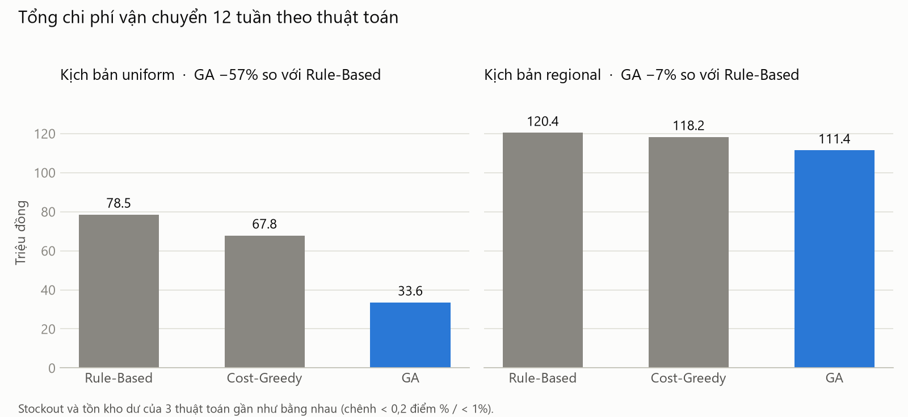
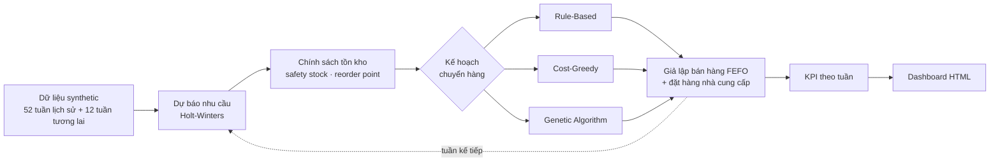
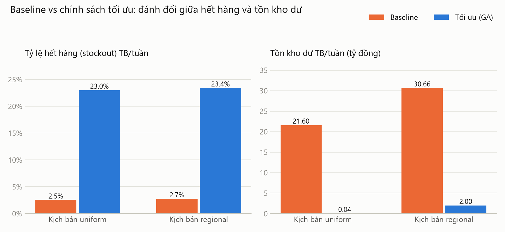
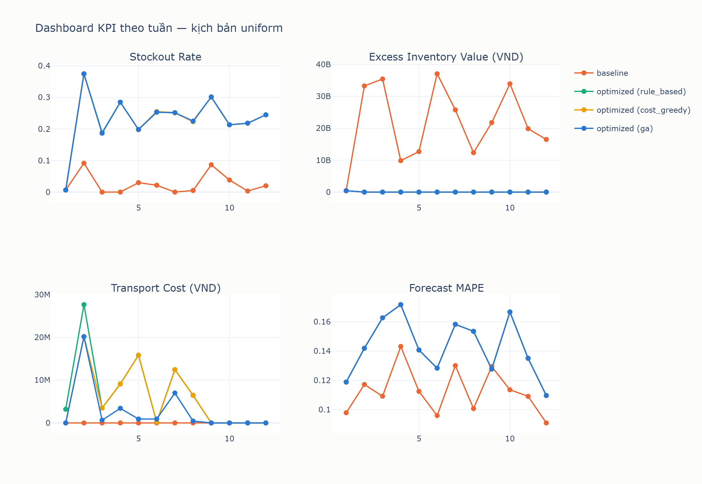
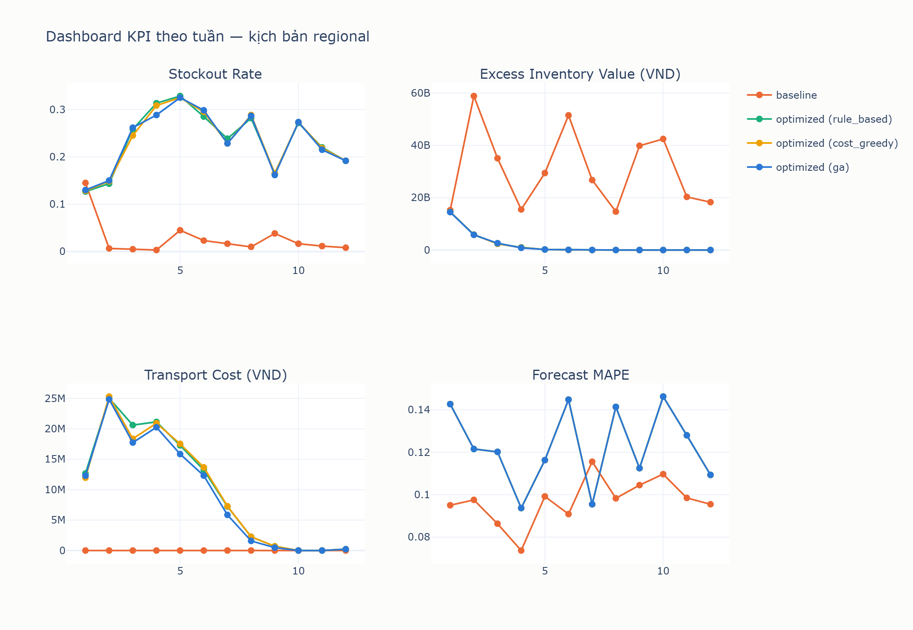

# Tối ưu chuyển hàng tồn kho giữa các cửa hàng bán lẻ

Hệ thống mô phỏng 12 tuần cho một chuỗi 20 cửa hàng: dự báo nhu cầu, tính tồn kho an toàn, rồi lập kế hoạch
chuyển hàng từ cửa hàng thừa sang cửa hàng thiếu bằng 3 thuật toán — **Rule-Based**, **Cost-Greedy** và
**Genetic Algorithm (GA)** — dưới ràng buộc sức chứa xe, lịch giao hàng và hạn sử dụng.

**Kết quả chính:** GA giảm **57% chi phí vận chuyển** so với Rule-Based (51% so với Cost-Greedy) mà vẫn giữ
nguyên mức phục vụ — nhờ biết gộp nhiều thiếu hụt nhỏ lên cùng một chuyến xe.



---

## 1. Vấn đề

Trong một chuỗi bán lẻ, cùng một mặt hàng thường **thừa ở cửa hàng này nhưng hết ở cửa hàng khác**. Hàng
thừa chôn vốn và có nguy cơ hết hạn; hàng thiếu làm mất doanh thu. Chuyển hàng ngang giữa các cửa hàng giải
quyết được cả hai, nhưng mỗi chuyến xe đều tốn tiền, nên câu hỏi thật sự là:

> Tuần này nên chuyển **mặt hàng nào, bao nhiêu, từ đâu đến đâu**, để cân bằng giữa chi phí vận chuyển,
> thiệt hại do hết hàng và vốn nằm trong tồn kho — mà vẫn tôn trọng các ràng buộc vận hành thực tế?

Ràng buộc vận hành được mô hình hóa:

- **Sức chứa xe:** 500 kg và 2 m³ mỗi tuyến mỗi tuần.
- **Lịch giao hàng:** mỗi cặp cửa hàng có lịch cố định.
- **Hạn sử dụng:** xuất lô hết hạn trước (FEFO), không chuyển lô còn dưới 7 ngày.
- **Phí vận chuyển:** 200.000đ cố định mỗi chuyến + 5.000đ/km.

## 2. Cách tiếp cận



| Thành phần | Cách làm |
|---|---|
| **Dữ liệu** | 20 cửa hàng ở 3 thành phố, 30 mã hàng thuộc 5 danh mục, 64 tuần bán hàng có mùa vụ theo ngày trong tuần, xu hướng và khuyến mãi. Hai kịch bản: **uniform** (nhu cầu gần đồng đều, chuyển hàng cả liên tỉnh) và **regional** (nhu cầu lệch mạnh giữa cửa hàng, tồn kho cấp tập trung, chỉ chuyển nội thành) |
| **Dự báo** | Holt-Winters (mùa vụ 7 ngày), tự rơi về trung bình trượt khi lịch sử quá ngắn |
| **Chính sách tồn kho** | Safety stock = Z(service level) × σ × √lead time, reorder point, đặt hàng nhà cung cấp lên mức order-up-to |
| **Rule-Based** | Thiếu nhiều nhất trước, lấy từ cửa hàng gần nhất. Không xét chi phí |
| **Cost-Greedy** | Dùng đúng thông tin GA dùng (phí tuyến, biên lợi nhuận) nhưng quyết định từng thiếu hụt một: chỉ chạy xe khi tiền lời từ hàng bù được ≥ phí chuyến |
| **Genetic Algorithm** | Mỗi cá thể là một kế hoạch chuyển hàng. Ràng buộc được xử lý bằng **repair** khi giải mã (mọi cá thể đều khả thi). Hàm mục tiêu = phí các tuyến + số đơn vị còn thiếu × biên lợi nhuận. Quần thể được **seed bằng nghiệm của 2 heuristic** nên GA không bao giờ tệ hơn chúng theo hàm mục tiêu. Đột biến có nhánh "về 0" để bỏ hẳn một tuyến |
| **Mô phỏng** | Rolling 12 tuần kiểu walk-forward: mỗi tuần dự báo → phân loại thừa/thiếu → lập kế hoạch → bán hàng theo nhu cầu thật của tuần đó → đo KPI. Chạy song song kịch bản **baseline** (logic v1: ngưỡng số ngày tồn kho, không chuyển hàng) để so sánh |

## 3. Kết quả

Trung bình 12 tuần, 20 cửa hàng × 30 mã hàng:

| KPI | Baseline | Rule-Based | Cost-Greedy | **GA** |
|---|---|---|---|---|
| **Kịch bản uniform** | | | | |
| Tổng chi phí vận chuyển | 0 | 78,5 triệu | 67,8 triệu | **33,6 triệu** |
| Tỷ lệ hết hàng (stockout) | 2,53% | 23,00% | 23,00% | 23,00% |
| Tồn kho dư TB/tuần | 21,60 tỷ | 35,6 triệu | 35,6 triệu | 35,6 triệu |
| **Kịch bản regional** | | | | |
| Tổng chi phí vận chuyển | 0 | 120,4 triệu | 118,2 triệu | **111,4 triệu** |
| Tỷ lệ hết hàng (stockout) | 2,75% | 23,53% | 23,46% | 23,42% |
| Tồn kho dư TB/tuần | 30,66 tỷ | 2,012 tỷ | 2,001 tỷ | 1,997 tỷ |

*Tồn kho dư* = giá vốn của phần tồn cuối tuần vượt nhu cầu trung bình × (lead time + 7 ngày), đo cùng một thước
cho mọi kịch bản.



**Dashboard KPI theo tuần** (file HTML tương tác sinh ra ở `dashboard/`):



<details>
<summary>Dashboard kịch bản regional</summary>



</details>

## 4. Insight

**1. GA tiết kiệm chủ yếu nhờ gộp chuyến, không phải nhờ "biết tính chi phí".**
Cost-Greedy có đủ thông tin chi phí như GA nhưng chỉ đạt **24%** mức tiết kiệm của GA so với Rule-Based. Phần
còn lại đến từ việc gộp nhiều thiếu hụt nhỏ lên cùng một chuyến để chia phí cố định. Ví dụ (có test minh họa):
hai mặt hàng mỗi thứ thiếu 3 đơn vị, chạy xe riêng cho từng thứ thì lỗ, gộp chung một chuyến thì có lời. Heuristic
xét từng thiếu hụt riêng lẻ không bao giờ thấy được tương tác này; GA thấy.

**2. Dư địa tối ưu phụ thuộc vào cấu trúc bài toán.** Ở kịch bản uniform có nhiều chuyến nhỏ, đắt (kể cả liên
tỉnh) nên GA giảm được 57%. Ở kịch bản regional các chuyến đều nội thành và thiếu hụt lớn, gần như chuyến nào cũng
đáng chạy, nên GA chỉ còn giảm 7%.

**3. Baseline và chính sách tối ưu là một phép đánh đổi, không phải bên nào thắng tuyệt đối.** Baseline luôn đặt
hàng lên mức 30 ngày nhu cầu nên hiếm khi hết hàng (2,5%) nhưng giữ **21–31 tỷ đồng** tồn kho dư. Chính sách tối
ưu giảm tồn kho dư **93–99,8%** nhưng tỷ lệ hết hàng cao gấp ~9 lần.

**4. Thuật toán chuyển hàng không cứu được một chính sách tồn kho lệch.** Stockout cao của kịch bản tối ưu có
nguyên nhân đã được kiểm chứng: reorder point chỉ phủ nhu cầu trong lead time (2–7 ngày), trong khi hệ thống chỉ
review mỗi 7 ngày — **80% cặp cửa hàng × mã hàng có reorder point thấp hơn nhu cầu 1 tuần**. Mọi thuật toán đều
chỉ bù hàng đến reorder point, nên chuyển khéo đến đâu cửa hàng vẫn hết hàng trong tuần. Hướng sửa: dùng ngưỡng
kích hoạt theo chu kỳ review, nhu cầu TB × (lead time + 7) + z·σ·√(lead time + 7).

**5. Mô hình dự báo phức tạp hơn chưa chắc chính xác hơn.** Để toàn bộ mô phỏng chạy dưới 15 phút, Holt-Winters
dùng tham số làm mượt cố định (nhanh hơn ~24 lần so với tự tối ưu tham số). Đổi lại, sai số MAPE theo tuần của nó
(14,3% / 12,3%) **cao hơn** trung bình trượt 14 ngày của baseline (11,2% / 9,7%).

## 5. Quá trình kiểm chứng

Chạy mô phỏng toàn quy mô và soi số liệu thật đã lộ ra nhiều lỗi mà unit test trên dữ liệu nhỏ không bắt được.
Mỗi lỗi được tái hiện bằng một test trước khi sửa:

- Sức chứa xe bị so thể tích **lít** với đơn vị **m³**, nên xe thực chất chỉ chở được 2 lít.
- GA không trừ hàng ở cửa hàng nguồn khi chuyển, tức là tự **tạo thêm tồn kho**; nhiều ứng viên cùng lô còn rút
  vượt số hàng thực có. Đã thêm test bảo toàn tồn kho cho mọi thuật toán.
- Tồn kho dư của baseline và tối ưu từng được đo trên **hai thước khác nhau**.
- Phiên bản đầu không có nguồn nhập hàng, nên cả 2 kịch bản cạn kho đồng loạt từ tuần 3 → bổ sung đặt hàng nhà
  cung cấp.
- Holt-Winters tự tối ưu tham số khiến mô phỏng mất ~47 phút → dùng tham số cố định, còn ~4 phút.

Toàn bộ dự án có **97 test** (pytest), viết theo TDD.

## 6. Giới hạn

Đây là mô phỏng trên dữ liệu synthetic, không phải hệ thống vận hành thật:

- Quy mô bán mỗi mã hàng cao (mỗi mã nên hiểu là một *nhóm hàng*), không có ngày bán bằng 0, nhu cầu tăng ~1%/tuần.
- Nhà cung cấp luôn giao đủ đúng sau 1 tuần — đây là lý do chính khiến chuyển hàng ngang ít tác động đến stockout.
- Hàng hết hạn chưa bị loại bỏ khỏi kho; lịch giao hàng mới chỉ dùng để xác định tuyến nào được chạy.
- Lịch sử nhu cầu của các tuần mô phỏng được ghi dưới dạng trung bình ngày, làm mất mùa vụ theo ngày trong tuần.
- Phí cố định 200.000đ/chuyến là giả định; khoảng cách tính theo đường chim bay.
- Stockout được đo theo kiểu có/không cho mỗi cặp cửa hàng × mã hàng mỗi tuần, chưa đo số đơn vị bán hụt.

## 7. Chạy thử

Cần Python 3.11+.

```bash
python -m venv .venv
.venv\Scripts\activate          # Windows; macOS/Linux: source .venv/bin/activate
pip install -r requirements.txt

python -m src.main --generate-data --simulate                      # kịch bản uniform
python -m src.main --generate-data --simulate --scenario regional  # kịch bản regional
pytest                                                             # 97 test
```

Kết quả ghi vào `results/` (KPI theo tuần, CSV) và `dashboard/` (HTML tương tác). Một lượt 12 tuần × 3 thuật toán
mất khoảng 4 phút. Dữ liệu sinh ra lấy ngày chạy làm mốc thời gian, nên số liệu khi tự chạy có thể chênh nhẹ so với
bảng ở trên.

## 8. Cấu trúc dự án

```
src/
├── data_generator/     sinh dữ liệu synthetic (2 kịch bản)
├── forecasting/        Holt-Winters + trung bình trượt
├── inventory_policy/   safety stock, reorder point, phân loại thừa/thiếu, đặt hàng NCC
├── optimization/       ràng buộc dùng chung, Rule-Based, Cost-Greedy, Genetic Algorithm
├── simulation/         chu kỳ 1 tuần, rolling 12 tuần, KPI
├── reporting/          dashboard Plotly
└── main.py             CLI
tests/                  97 test
docs/
├── requirements/       BRD và 3 use case
├── architecture/       thiết kế kỹ thuật
└── plans/              kế hoạch triển khai
```

Tài liệu nghiệp vụ đầy đủ: [BRD](docs/requirements/BRD.md) · [Thiết kế kỹ thuật](docs/architecture/technical-design.md)
